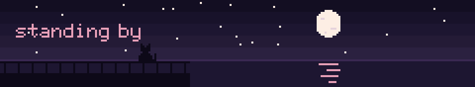

<p align="center">
  
</p>

<p align="center">
  Estudante de <b>Ciência da Computação</b> construindo pipelines de dados<br>
  com <b>Python</b>, <b>SQL</b> e <b>Docker</b>. Buscando estágio em <b>Engenharia ou Análise de Dados</b>.
</p>

<p align="center">
  <a href="https://www.linkedin.com/in/saulo-carvalho-127764396/"></a>
  <a href="mailto:saulo.marcelcc@gmail.com"></a>
  <a href="https://github.com/SaaaS04/Monitor_de_juros"></a>
</p>

<br>


<table>
<tr>
<td valign="top" width="55%">

Gosto da parte do trabalho que ninguém vê: pegar um dado cru, entender o que ele quer dizer e deixar pronto pra alguém tirar uma resposta dele.

- **Python** é minha base: Pandas e NumPy pra tratar dados, Jupyter pra explorar antes de automatizar
- **SQL**: joins, CTEs e window functions, com PostgreSQL
- **Docker** pra subir bancos e ter ambientes reproduzíveis
- Já passei por **web** (Node.js) e **mobile** (Flutter + Firebase)
- Vivo no **Linux**, entre Git, zsh e tmux

</td>
<td valign="top" width="45%">

```sql
SELECT curso, foco, estudando
FROM   perfil
WHERE  nome = 'Saulo Carvalho';

-- curso     | Ciência da Computação
-- foco      | Data Engineering
-- estudando | SQL, ETL, Docker, dbt
-- (1 row)
```

</td>
</tr>
</table>

<br>


<table align="center">
<tr>
<td align="right" valign="middle"><b>Dados</b></td>
<td>


</td>
</tr>
<tr>
<td align="right" valign="middle"><b>Ferramentas</b></td>
<td>


</td>
</tr>
<tr>
<td align="right" valign="middle"><b>Web & Mobile</b></td>
<td>


</td>
</tr>
<tr>
<td align="right" valign="middle"><b>Aprendendo</b></td>
<td>


</td>
</tr>
</table>

<br>


<table>
<tr>
<td colspan="2" valign="top">

### [Monitor de Juros dos Bancos](https://github.com/SaaaS04/Monitor_de_juros) <sub><sup>⭐ DESTAQUE</sup></sub>
Pipeline ETL que coleta as taxas de juros de cada banco na API de dados abertos do **Banco Central** e responde: *qual banco cobra mais caro? Bancos digitais cobram menos?*

- **Extrai** da API Olinda → **trata** com Pandas → **carrega** no PostgreSQL (Docker)
- Camadas bronze → prata → ouro: JSON bruto → Parquet → tabelas de análise


</td>
</tr>
<tr>
<td valign="top" width="50%">

### [SQL Clientes & Produtos](https://github.com/SaaaS04/SQL_clientes_produtos)
Um banco de clientes e produtos pra praticar SQL do básico ao avançado, de `JOIN` e `GROUP BY` até CTEs e window functions.


</td>
<td valign="top" width="50%">

### [FitGroup](https://github.com/cdantass/fitgroup)
App de treino em grupo feito por uma equipe de seis pessoas (80+ commits). Fiz as telas **Seus Grupos** e **Descobrir Grupos**, com dados do Firestore.


</td>
</tr>
<tr>
<td colspan="2" valign="top">

### [Sistema de Notas](https://github.com/SaaaS04/Sistema-de-notas-com-estatistica)
Lê notas de um CSV e calcula as estatísticas com Pandas, direto no terminal. Meu primeiro projeto de dados, onde tudo começou.


</td>
</tr>
</table>

<br>


<p align="center">
  
</p>

<picture>
  <source media="(prefers-color-scheme: dark)" srcset="https://raw.githubusercontent.com/SaaaS04/SaaaS04/output/github-snake-dark.svg">
  <source media="(prefers-color-scheme: light)" srcset="https://raw.githubusercontent.com/SaaaS04/SaaaS04/output/github-snake-light.svg">
  
</picture>

<br>


<p align="center">
  Se você chegou até aqui, bora conversar.<br>
  Estou aberto a <b>estágio</b>, projetos e trocas sobre dados.
</p>

<p align="center">
  <a href="https://www.linkedin.com/in/saulo-carvalho-127764396/"></a>
  <a href="mailto:saulo.marcelcc@gmail.com"></a>
  <br>
  <sub><code>saulo.marcelcc@gmail.com</code></sub>
</p>



<p align="center">
  
</p>
